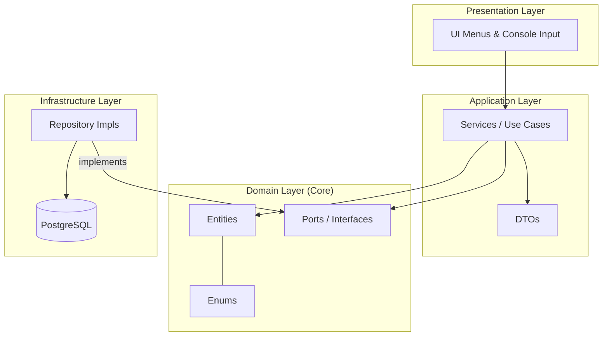

# Health Pharmacy

[](https://www.oracle.com/java/)
[](https://maven.apache.org/)
[](https://www.postgresql.org/)
[](LICENSE)
[](https://github.com/brunoliratm/health-pharmacy/commits/main)


A clean, layered Java console application for pharmacy operations: customer management, product catalog, and checkout/order finalization.

## Why this project

Health Pharmacy is a practical backend-focused system that demonstrates:

- Domain-driven structure with clear boundaries
- Use-case oriented application services
- JPA/Hibernate persistence with PostgreSQL
- Input validation and business-rule enforcement
- Menu-based console UI for end-to-end flows

## Tech Stack

- Java 21
- Maven
- JPA (Hibernate 5.6)
- PostgreSQL
- Logback

See [pom.xml](pom.xml) for dependencies and plugin configuration.

## Architecture

The project follows a layered architecture inspired by Ports & Adapters:



- **Domain**
  - Entities and business contracts
  - Packages: [src/main/java/com/healthpharmacy/domain](src/main/java/com/healthpharmacy/domain)
- **Application**
  - DTOs + use-case implementations (services)
  - Packages: [src/main/java/com/healthpharmacy/application](src/main/java/com/healthpharmacy/application)
- **Infrastructure**
  - Repository implementations and custom exceptions
  - Packages: [src/main/java/com/healthpharmacy/infrastructure](src/main/java/com/healthpharmacy/infrastructure)
- **Presentation**
  - Console menus and input helpers
  - Packages: [src/main/java/com/healthpharmacy/presentation](src/main/java/com/healthpharmacy/presentation)

Application entry point: [src/main/java/com/healthpharmacy/Main.java](src/main/java/com/healthpharmacy/Main.java)

## Core Features

- **Customer management**
  - Create, update, list, soft-delete customers
- **Product management**
  - Create, update, list, soft-delete products
  - Category and price validation
- **Checkout flow**
  - Authenticate customer
  - Add products to order
  - Choose payment method
  - Finalize order with total calculation

## Domain Snapshot

Main entities:

- [Customer](src/main/java/com/healthpharmacy/domain/entity/Customer.java)
- [Product](src/main/java/com/healthpharmacy/domain/entity/Product.java)
- [FinalizedOrder](src/main/java/com/healthpharmacy/domain/entity/FinalizedOrder.java)

Key enums:

- [ProductCategory](src/main/java/com/healthpharmacy/domain/constant/ProductCategory.java)
- [PaymentMethod](src/main/java/com/healthpharmacy/domain/constant/PaymentMethod.java)

## Getting Started

### 1) Prerequisites

- JDK 21+
- Maven 3.9+
- PostgreSQL running locally

### 2) Database Setup

Create a PostgreSQL database named `healthpharmacy`.

Review database credentials in [src/main/resources/META-INF/persistence.xml](src/main/resources/META-INF/persistence.xml):

- `javax.persistence.jdbc.url`
- `javax.persistence.jdbc.user`
- `javax.persistence.jdbc.password`

Current default URL:

- `jdbc:postgresql://localhost:5432/healthpharmacy`

### 3) Build

```bash
mvn clean compile
```

### 4) Run

```bash
mvn exec:java
```

Because `exec-maven-plugin` is already configured, no extra main-class argument is needed.

## Business Rules (Highlights)

- CPF must contain exactly 11 numeric digits
- Product price must be greater than 0
- Inactive records are hidden using soft delete (`active = false`)
- Checkout validates customer credentials before finalizing
- Order total is computed from selected product prices

## Exception Strategy

Custom exception set:

- [ValidationException](src/main/java/com/healthpharmacy/infrastructure/exception/ValidationException.java)
- [AlreadyExistsException](src/main/java/com/healthpharmacy/infrastructure/exception/AlreadyExistsException.java)
- [EntityNotFoundException](src/main/java/com/healthpharmacy/infrastructure/exception/EntityNotFoundException.java)
- [PersistenceException](src/main/java/com/healthpharmacy/infrastructure/exception/PersistenceException.java)

## Useful Commands

```bash
# Compile
mvn clean compile

# Package artifact (WAR)
mvn clean package
```

Output artifact: [target](target)

## Project Structure

```text
src/main/java/com/healthpharmacy
├── application
│   ├── dto
│   └── service
├── domain
│   ├── constant
│   ├── entity
│   └── port
├── infrastructure
│   ├── exception
│   └── repository
└── presentation
 └── ui
```

## Author

- Bruno Lira — [@brunoliratm](https://github.com/brunoliratm)

## License

This project is licensed under the MIT License. See [LICENSE](LICENSE).
